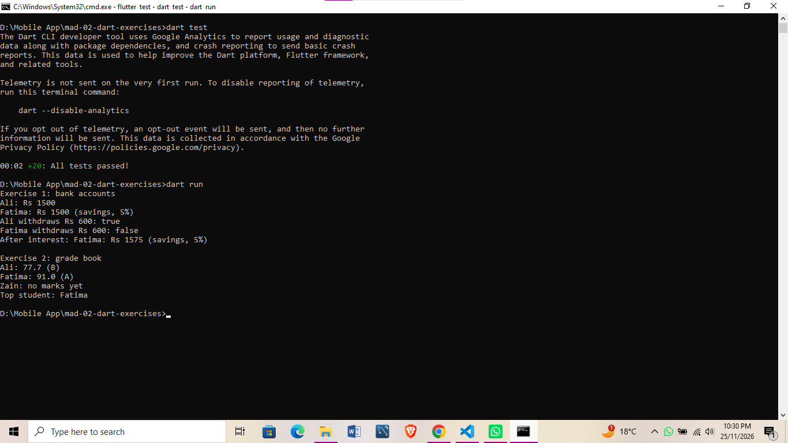

# Bank account and grade book: week 2 exercises

Dart console exercises for week 2 of Mobile Application Development (requires Dart 3.14.0 or newer).

## How to run

Open a terminal in the project folder and run:

```bash
dart pub get
dart run
```

This runs `bin/dart_exercises.dart` and prints the Exercise 1 bank account report and Exercise 2 grade book summary.

## Your six tasks

Open `lib/bank_account.dart` and complete **TODO 1** and **TODO 2**, then open `lib/grade_book.dart` and complete **TODO 3** through **TODO 6** as instructed in the handout.

## How I completed this project (Step-by-Step)

* **Environment & Starter Setup:** Verified the Dart SDK, cloned the `mad-02-dart-exercises` template repository, and installed dependencies using `dart pub get`.
* **Exercise 1 (`lib/bank_account.dart`):**
  * **TODO 1:** Added an initializer list (`: _balance = openingBalance`) to the `BankAccount` constructor and removed the default `= 0` from `_balance`.
  * **TODO 2:** Overrode `withdraw(int amount)` in `SavingsAccount` to return `false` if `balance - amount < minimumBalance`, otherwise delegating to `super.withdraw(amount)`.
* **Exercise 2 (`lib/grade_book.dart`):**
  * **TODO 3:** Implemented `Grade.forAverage` by looping through `Grade.values` and returning the first grade where `average >= grade.minAverage`.
  * **TODO 4:** Implemented the `Student.average` getter to return `null` when `_marks` is empty, or calculate the mean of `_marks`.
  * **TODO 5:** Implemented `GradeBook.find` to return `_students[name]`.
  * **TODO 6:** Implemented the `GradeBook.topStudent` getter to iterate through `_students.values` and return the `Student` with the highest average (or `null` if none have marks).
* **Testing & Static Analysis:** Ran `dart test` to confirm all 20 unit tests pass (`+20: All tests passed!`), compared `dart run` output against `bin/grade_book_v0.dart`, and verified zero issues with `dart analyze`.
* **Documentation & GitHub Push:** Saved the terminal output as `screenshot.png` in the project root, updated `README.md`, and pushed all changes to GitHub using `git add .`, `git commit`, and `git push`.

## Tests

Run tests with:

```bash
dart test
```

Nine tests fail initially until all six TODOs are completed, eventually showing `All tests passed!`.

## My screenshot



## AI note

I asked AI to explain the given code line by line, guide me through the logic for the six TODOs, and help push the completed project to GitHub.
